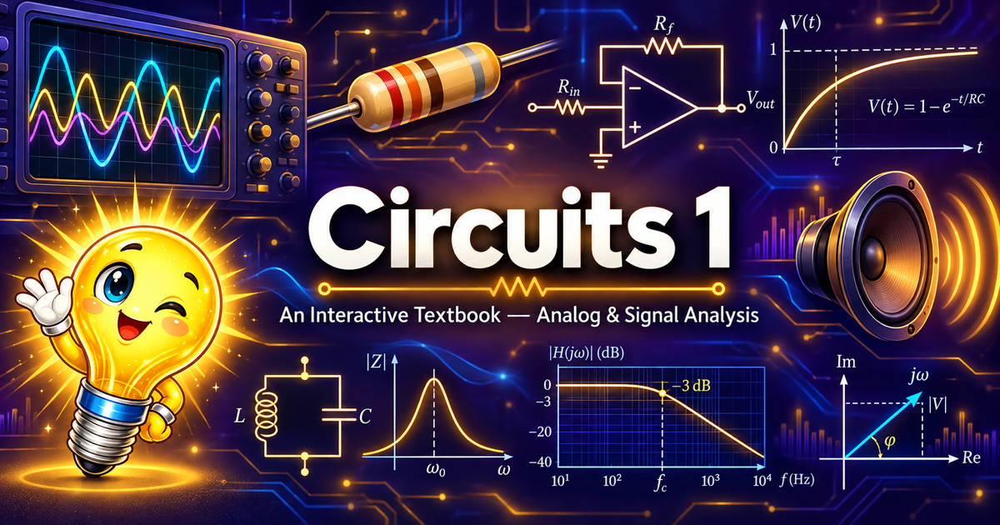

# Welcome

Welcome to **Circuits 1**, an interactive textbook on analog electrical circuits and signal analysis for college students in electrical engineering and computer science.

<figure markdown>
  { width="100%" }
</figure>

## About This Book

Circuits 1 bridges the mathematical foundations of circuit theory with practical, hands-on circuit design, using audio systems as a unifying theme. Students learn to analyze circuits in both the time and frequency domains, develop intuition for how resistors, capacitors, and inductors shape electrical signals, and build toward active circuit design with operational amplifiers — the gateway to real audio processing circuits like filters, amplifiers, and tone shapers.

The book combines concise written explanations, AI-generated worked examples, and interactive **MicroSims** you can run in your browser to see circuit behavior change as you turn the knobs.

## Who This Book Is For

- First- and second-year college students majoring in electrical engineering or computer science
- Self-learners with a calculus background who want a modern, interactive introduction to analog circuits
- Instructors looking for a Creative-Commons textbook with ready-made simulations, quizzes, and a learning graph

**Prerequisites:** introductory calculus (derivatives and integrals), basic algebra including complex numbers, and — recommended but not required — a first physics course covering electricity and magnetism.

## How to Use This Book

Use the left-hand navigation to explore:

- **[Chapters](chapters/01-electric-charge-basic-quantities/)** — the core 16-chapter sequence, from electric charge through op-amp audio circuits
- **[MicroSims](sims/)** — 50+ interactive simulations for hands-on exploration
- **[Learning Graph](learning-graph/)** — an interactive visualization of the 300 concepts in the book and how they connect
- **[Prompts](prompts/)** — AI prompt examples for generating circuit diagrams, worked examples, and more
- **[FAQ](faq.md)** — common questions about the course and the toolkit
- **[Glossary](glossary.md)** — key terms and definitions
- **[About](about.md)** — motivation, author, license, and citation

## Getting Started

Jump in with [Chapter 1 — Electric Charge and Basic Quantities](chapters/01-electric-charge-basic-quantities/) to begin.
